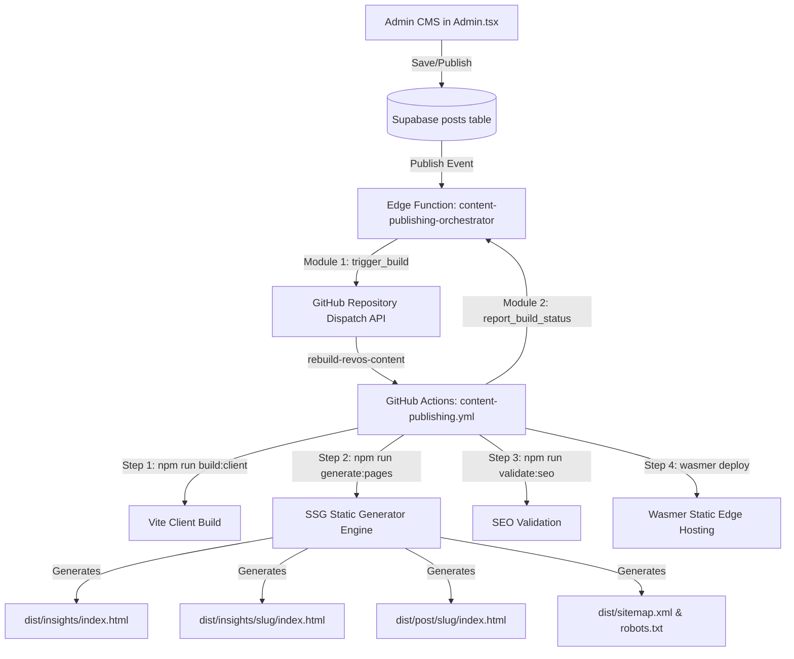

# RevOS Unified Content SSG Architecture V1.0
**Production Specification & Architecture Manual**

---

## 1. Architectural Philosophy

RevOS adopts a high-performance **hybrid rendering architecture**:
* **Static Site Generation (SSG)** for all public, indexable editorial content (`/blog/`, `/post/:slug/`, `/insights/`, `/insights/:slug/`, `sitemap.xml`, `robots.txt`).
* **Client-Side Rendering (CSR)** for interactive platform capabilities (Homepage, RevOS Dashboard, GTMOS, Lead Qualification Engine, Pipeline Assessment Engine, Admin CMS, and Authenticated User Experiences).

This hybrid approach guarantees zero-latency, search-engine-crawlable static HTML without incurring server-side rendering (SSR) operational overhead.

---

## 2. Unified Content Model

Both content categories share the primary `public.posts` table in Supabase, distinguished by the `content_type` classification column:

| Content Type | Purpose | Primary Public Route | Target Audience |
| :--- | :--- | :--- | :--- |
| **`post`** | Founder Insights, personal essays, reflections, and company updates. | `/about/founderInsights` `/post/:slug/` | General audience, investors, community, founders. |
| **`insight`** | Deep-dive revenue operations, sales methodology, and pipeline governance. | `/insights` `/insights/:slug/` | B2B enterprise executives, VP of Sales, CROs, RevOps leaders (SEO Driver). |

---

## 3. Database Schema Mapping & Extension

### Primary Table: `public.posts`
* **`id`** (`UUID PRIMARY KEY`): Unique content record identifier.
* **`content_type`** (`TEXT NOT NULL DEFAULT 'post'`): `'post'` or `'insight'`.
* **`status`** (`TEXT NOT NULL DEFAULT 'published'`): `'draft'`, `'published'`, or `'archived'`.
* **`title`** (`TEXT NOT NULL`): Article headline.
* **`slug`** (`TEXT NOT NULL UNIQUE`): URL slug.
* **`summary`** (`TEXT NOT NULL`): Key Takeaways & excerpt.
* **`content`** (`TEXT NOT NULL`): Sanitized article body (Tiptap HTML).
* **`category`** (`TEXT NOT NULL`): Associated category name.
* **`category_id`** (`UUID`): Relational foreign key referencing `public.categories(id)`.
* **`read_time`** (`INTEGER NOT NULL`): Estimated reading duration in minutes.
* **`thumbnail_url`** (`TEXT NOT NULL`): Hero image URL in Supabase Storage (`blog-images`).
* **`is_featured`** (`BOOLEAN DEFAULT false`): Pinned hero card status.
* **`published_at`** (`TIMESTAMPTZ`): Publication timestamp.
* **`created_at`** (`TIMESTAMPTZ NOT NULL`): Creation timestamp.
* **`updated_at`** (`TIMESTAMPTZ`): Last modified timestamp.
* **`seo_title`** (`TEXT`): Custom search engine `<title>` tag override.
* **`seo_description`** (`TEXT`): Custom `<meta name="description">` override.
* **`canonical_url`** (`TEXT`): Custom canonical URL override.
* **`target_keyword`** (`TEXT`): Primary target keyword for SEO audits.

---

## 4. Static Generation & Publishing Pipeline

---

## 5. Consolidated Supabase Edge Function Architecture

**Function Name**: `content-publishing-orchestrator`

Consolidates three core responsibilities into a single function with an action-based router:
1. **Module 1: Publication & Build Orchestration (`action: "trigger_build"`)**
   * Validates publication eligibility.
   * Dispatches `rebuild-revos-content` event to GitHub Actions via the Repository Dispatch API.
   * Generates a traceable `build_request_id`.
2. **Module 2: Build & Deployment Status Management (`action: "report_build_status"`, `action: "get_latest_status"`)**
   * Records deployment progression: `requested` → `building` → `build_succeeded` → `deploying` → `deployment_succeeded`.
   * Persists logs to `public.content_publishing_logs`.
3. **Module 3: Content Validation & Publication Integrity (`action: "validate_publication"`)**
   * Validates title, body content, slug format, and slug uniqueness before publication.

---

## 6. Public URLs & Routing

* **Founder Blog Listing**: `/about/founderInsights` (and `/blog` alias)
* **Founder Blog Detail**: `/post/:slug` (and `/blog/:slug` alias)
* **Revenue Insights Listing**: `/insights`
* **Revenue Insight Detail**: `/insights/:slug`
* **Resources Navbar**: Linked via `Revenue Insights` in `src/components/ResourcesDropdown.tsx`
* **Footer Navigation**: Linked via `Revenue Insights` in `src/components/Footer.tsx`
