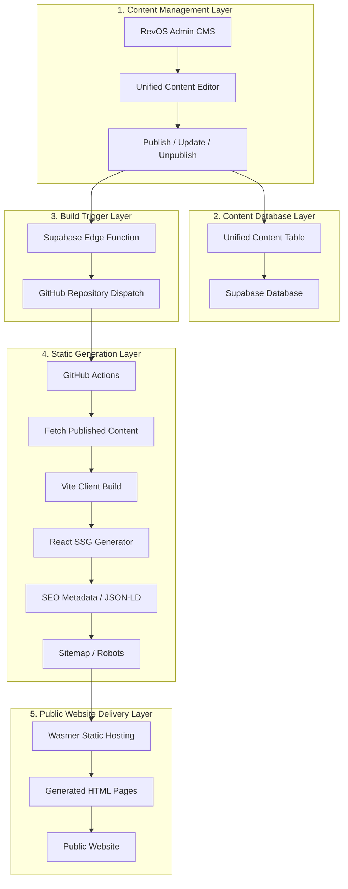
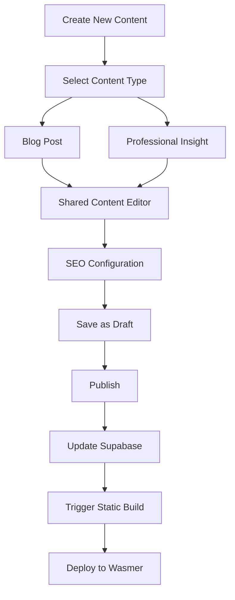

# RevOS Unified Content SSG Architecture V1.0

**Document Type:** Technical Architecture Specification  
**Version:** 1.0  
**Status:** Proposed Baseline Specification  
**Platform:** RevOS  
**Frontend:** React + Vite + TypeScript  
**Database:** Supabase  
**Hosting:** Wasmer Static Website Hosting  
**Build & Deployment:** GitHub Actions + Wasmer CLI

---

# 1. Executive Summary

## 1.1 Purpose

This document defines the technical architecture for implementing a Unified Content Management and Static Site Generation (SSG) system for the RevOS website.

The objective is to improve the discoverability, indexing, and organic search performance of RevOS content while retaining the existing website architecture, CMS functionality, and development investment.

The architecture introduces a unified content management model supporting two distinct content categories:

- **Blog:** Personal articles, company updates, announcements, and general editorial content, with content type of "post".
- **Insights:** Professional, educational, analytical, and SEO-oriented articles related to revenue operations, sales management, lead qualification, pipeline management, GTM strategy, and other RevOS subject areas, with content type of "insight".

Both content categories will share the same underlying database, CMS, content management logic, rendering components, and SEO infrastructure.

However, they will maintain separate public-facing URL namespaces and content experiences.

The public content pages will use Static Site Generation (SSG), producing complete HTML files during the build process. These files will be deployed to Wasmer as a static website.

The existing RevOS application, including its authenticated dashboard, administrative interface, and business engines, will continue using Client-Side Rendering (CSR).

## 1.2 Key Architectural Decisions

| Area | Architectural decision |
|---|---|
| Content management | Unified CMS |
| Content database | Shared Supabase content table |
| Content classification | `post` and `insight` |
| Blog URL | `/blog/` |
| Blog detail URL | `/blog/:slug/` |
| Insights URL | `/insights/` |
| Insights detail URL | `/insights/:slug/` |
| Public content rendering | Static Site Generation |
| Application rendering | Client-Side Rendering |
| Build process | Vite + React + TypeScript |
| Content retrieval | Supabase |
| Build automation | GitHub Actions |
| Hosting and deployment | Wasmer |
| SEO metadata | Generated at build time |
| Sitemap | Generated automatically |
| Draft preview | Authenticated CSR |
| Request-time rendering server | Not required in V1.0 |

## 1.3 Core Principle

RevOS will adopt a hybrid rendering architecture:

**SSG for public, indexable content; CSR for interactive application functionality.**

The architecture must reuse existing business logic, UI components, CMS functionality, and database infrastructure wherever practical.

It must not introduce unnecessary architectural complexity or require a complete redesign of the existing website.

---

# 2. Architecture Objectives

The implementation must achieve the following objectives.

### 2.1 SEO and Search Engine Discoverability

- Generate complete HTML pages for published Blog and Insights content.
- Ensure article content is available in the initial HTML response without requiring JavaScript execution.
- Generate unique SEO titles and meta descriptions for each page.
- Generate canonical URLs.
- Generate Open Graph and social-sharing metadata.
- Generate structured data using Schema.org JSON-LD.
- Automatically generate and update XML sitemaps.
- Support search engine crawling and indexing.
- Ensure unpublished and draft content is never exposed through public static pages.

### 2.2 Unified Content Management

- Reuse the existing CMS.
- Maintain one content management interface.
- Maintain one underlying content database.
- Support both Blog and Insights through content classification.
- Reuse existing content creation, editing, publishing, and deletion workflows.
- Support category, tag, author, publication date, featured image, and SEO metadata.
- Avoid duplicating content management logic.

### 2.3 Maintainability and Scalability

- Reuse common React components.
- Separate content retrieval from presentation and rendering.
- Separate build-time content generation from browser-side application execution.
- Automate static page generation after content publication.
- Support future content types without rebuilding the entire architecture.

### 2.4 Performance

- Serve public content as static HTML.
- Minimize unnecessary browser-side data requests.
- Reduce dependence on client-side rendering for public article pages.
- Reuse existing static assets.
- Avoid introducing a request-time SSR server in V1.0.

---

# 3. Target System Architecture

## 3.1 High-Level Architecture

The architecture consists of five principal layers:

1. Content Management Layer
2. Content Database Layer
3. Static Generation Layer
4. Automated Build and Deployment Layer
5. Public Website Delivery Layer

### Architecture diagram



## 3.2 Architectural Responsibilities

| Component | Responsibility |
|---|---|
| RevOS Admin CMS | Content creation and management |
| Unified Content Editor | Shared editing interface for Blog and Insights |
| Supabase Database | Stores content and publication status |
| Supabase Edge Function | Securely triggers the static generation workflow |
| GitHub Actions | Coordinates automated builds and deployment |
| Vite | Builds frontend assets |
| React SSG Generator | Generates static HTML pages |
| SEO Generator | Creates metadata and structured data |
| Sitemap Generator | Creates XML sitemap and robots.txt |
| Wasmer | Hosts and serves generated static files |

## 3.3 Rendering Strategy

The website must use different rendering strategies depending on the page type.

| Website section | Rendering strategy | Reason |
|---|---|---|
| Homepage | Existing CSR | Preserve current functionality |
| Product pages | Existing CSR initially | Avoid unnecessary migration |
| Login / Registration | CSR | Interactive authentication |
| RevOS Dashboard | CSR | Authenticated application |
| Admin CMS | CSR | Interactive management |
| GTMOS Engine | CSR | Application functionality |
| Lead Qualification Engine | CSR | Application functionality |
| Pipeline Assessment Engine | CSR | Application functionality |
| Blog Listing | SSG | Search engine discoverability |
| Blog Detail | SSG | Search engine discoverability |
| Insights Listing | SSG | Search engine discoverability |
| Insights Detail | SSG | Search engine discoverability |

**Important:** V1.0 does not require request-time SSR.

React server rendering will be executed during the build process to produce static HTML files. Once deployed, Wasmer simply serves those files to visitors.

---

# 4. Unified Content Data Architecture

## 4.1 Content Classification

The existing content management system must be extended to support a master content classification field.

The classification field is:

`content_type`

Supported values:

- `post`
- `insight`

### Content type definitions

| Content type | Description | Public URL |
|---|---|---|
| `post` | Personal blog posts and general editorial content | `/blog/:slug/` |
| `insight` | Professional, educational, and SEO-oriented articles | `/insights/:slug/` |

The classification must determine the content's public URL namespace, listing page, and content presentation rules.

It must not require separate database tables.

## 4.2 Unified Database Model

The existing content table should be extended rather than replaced.

The following is the proposed logical schema. Before implementation, inspect the actual Supabase schema and map these fields to existing column names wherever possible.

### Core content fields

| Field | Suggested type | Description |
|---|---|---|
| `id` | UUID | Unique content identifier |
| `content_type` | TEXT | `post` or `insight` |
| `title` | TEXT | Content title |
| `slug` | TEXT | URL-friendly unique identifier |
| `excerpt` | TEXT | Short content summary |
| `content` | TEXT / JSONB | Main article content |
| `featured_image` | TEXT | Featured image URL |
| `author_id` | UUID | Author reference |
| `category_id` | UUID | Category reference, if supported |
| `tags` | TEXT[] / JSONB | Content tags |
| `status` | TEXT | Draft, published, archived, etc. |
| `published_at` | TIMESTAMPTZ | Publication date |
| `created_at` | TIMESTAMPTZ | Creation date |
| `updated_at` | TIMESTAMPTZ | Last modification date |

### SEO fields

| Field | Suggested type | Description |
|---|---|---|
| `seo_title` | TEXT | Search engine title |
| `seo_description` | TEXT | Search engine description |
| `canonical_url` | TEXT | Preferred canonical URL |
| `og_title` | TEXT | Open Graph title |
| `og_description` | TEXT | Open Graph description |
| `og_image` | TEXT | Social-sharing image |
| `target_keyword` | TEXT | Primary SEO keyword |

SEO fields should be optional at the database level where appropriate. The generation process should apply documented fallbacks when fields are missing.

### Additional optional fields

The architecture may support the following fields in future versions:

- `reading_time`
- `featured`
- `allow_comments`
- `robots_index`
- `robots_follow`
- `content_language`
- `last_reviewed_at`
- `content_updated_at`

These should only be added when the existing CMS or SEO requirements justify them.

## 4.3 Database Design Principles

1. Retain the existing content table wherever possible.
2. Add `content_type` without breaking existing Blog records.
3. Existing Blog records should default to `post`.
4. Existing content IDs and relationships must remain unchanged.
5. Do not duplicate content into separate Blog and Insights tables.
6. Use a shared content retrieval service.
7. Ensure that only publicly published content can be retrieved by the public generation process.
8. Enforce appropriate database constraints and indexes.

### Recommended constraints and indexes

- Unique slug within each content type, or a globally unique slug if that is already the existing design.
- Index on `content_type`.
- Index on publication status.
- Index on `published_at`.
- Composite index for frequently used listing queries, such as `content_type`, `status`, and `published_at`.

The actual uniqueness rule must be consistent with the existing URL and slug design.

---

# 5. Unified CMS Architecture

## 5.1 CMS Design Principle

The existing CMS must be extended to support both Blog and Insights.

The CMS should not introduce a completely separate Insights management system.

Instead, it should provide a shared content editor with content-type selection.

## 5.2 Content Management Workflow



## 5.3 Shared Editor Requirements

Both content types should reuse:

- Title input
- Slug generator
- Excerpt editor
- Rich-text or Markdown editor
- Featured image uploader
- Category selector
- Tag selector
- Author selector
- Publication status
- Publication date
- SEO title
- SEO description
- Canonical URL
- Open Graph fields
- Target keyword

The editor may display different contextual descriptions or default values depending on whether the user selects Blog or Insights.

However, the underlying editing functionality should remain shared.

## 5.4 Publishing Status

The CMS must distinguish between:

- Draft
- Published
- Unpublished
- Archived
- Deleted

The actual values should follow the existing CMS status conventions.

Only records that meet the public publication criteria may enter the SSG generation process.

A draft must never become publicly accessible through generated static HTML.

## 5.5 Draft Preview

Draft preview should continue to use the existing authenticated CSR mechanism.

Draft content should not be included in:

- Public listing pages
- Public article pages
- XML sitemap
- Public structured data
- Public static generation output

---

# 6. Public URL and Routing Architecture

## 6.1 URL Structure

The public website must maintain separate URL namespaces.

### Blog

Listing:

`https://www.example.com/blog/`

Article:

`https://www.example.com/blog/my-professional-journey/`

### Insights

Listing:

`https://www.example.com/insights/`

Article:

`https://www.example.com/insights/what-is-revenue-operations/`

The production domain must use the actual configured RevOS canonical domain.

## 6.2 URL Generation Rules

The content type determines the URL prefix.

Conceptually:

```ts
function getContentUrl(content: Content): string {
  const prefix =
    content.content_type === "insight"
      ? "/insights"
      : "/blog";

  return `${prefix}/${content.slug}/`;
}
```

Listing URLs:

```ts
const BLOG_URL = "/blog/";
const INSIGHTS_URL = "/insights/";
```

All generated article URLs must consistently use trailing slashes.

## 6.3 Static Directory Structure

The SSG generator must produce the following structure inside the Vite build output directory.

```text
dist/
│
├── index.html
├── 404.html
│
├── assets/
│   ├── index-xxxxx.js
│   ├── index-xxxxx.css
│   └── ...
│
├── blog/
│   ├── index.html
│   └── my-professional-journey/
│       └── index.html
│
├── insights/
│   ├── index.html
│   ├── what-is-revenue-operations/
│   │   └── index.html
│   └── how-to-improve-sales-pipeline/
│       └── index.html
│
├── sitemap.xml
└── robots.txt
```

Each published article must have its own physical HTML file.

The article page must contain its own content and metadata in the initial HTML response.

## 6.4 Wasmer Routing Requirements

Wasmer must serve the generated static files directly.

The static hosting configuration must:

1. Use `dist` as the website root.
2. Serve directory index files for trailing-slash URLs.
3. Return the correct HTML file for each generated article URL.
4. Return a genuine 404 response for nonexistent article URLs.
5. Avoid silently returning the generic RevOS application `index.html` for missing Blog or Insights URLs.

The implementation must verify the actual Wasmer static-site routing behavior before production deployment.

**Critical requirement:** Do not allow an SPA fallback to return HTTP 200 for a nonexistent article page. This can create soft-404 problems for search engines.

The existing application's CSR routing must remain functional for its existing routes.

---

# 7. React SSG Rendering Architecture

## 7.1 Rendering Design

The existing React components should be refactored to support both static generation and browser hydration.

The objective is to reuse the same presentation components rather than maintain two separate implementations.

The recommended rendering structure is:

```text
src/
│
├── components/
│   └── content/
│       ├── ContentCard.tsx
│       ├── ContentListing.tsx
│       ├── ContentDetail.tsx
│       ├── ContentHeader.tsx
│       ├── ContentBody.tsx
│       ├── ContentMetadata.tsx
│       └── RelatedContent.tsx
│
├── pages/
│   ├── BlogPage.tsx
│   ├── BlogDetailPage.tsx
│   ├── InsightsPage.tsx
│   └── InsightsDetailPage.tsx
│
├── seo/
│   ├── SeoMetadata.tsx
│   ├── JsonLd.tsx
│   └── seoUtils.ts
│
├── services/
│   └── contentService.ts
│
├── entry-client.tsx
├── entry-server.tsx
└── App.tsx
│
scripts/
├── generate-static-pages.ts
├── generate-sitemap.ts
└── validate-seo.ts
```

This is a recommended logical structure, not a requirement to reproduce the exact directory layout. Existing project conventions should be preserved where practical.

## 7.2 Separation of Responsibilities

The implementation must separate three responsibilities.

### A. Content Retrieval

Responsible for fetching published content from Supabase.

Example:

```ts
async function getPublishedContent() {
  // Fetch published content from Supabase.
}
```

### B. Presentation

Responsible for rendering content using reusable React components.

Example:

```tsx
function ContentDetail({ content }: Props) {
  return (
    <article>
      <h1>{content.title}</h1>
      <ContentMetadata content={content} />
      <ContentBody content={content} />
    </article>
  );
}
```

The presentation components must not depend on a browser-only Supabase request to display their initial content.

### C. Static Generation

Responsible for obtaining published content, rendering React components into HTML, and writing the generated files to disk.

The generation process should call the same presentation components used by the browser.

## 7.3 Server Entry Point

Create a React server rendering entry point.

Example:

```tsx
import React from "react";
import { renderToString } from "react-dom/server";

export function renderPage(page: React.ReactElement) {
  return renderToString(page);
}
```

The server entry point must support rendering:

- Blog listing pages
- Blog article pages
- Insights listing pages
- Insights article pages

It should also support the correct metadata and page-specific initial data.

## 7.4 Client Entry Point

Create a browser entry point using React hydration.

Example:

```tsx
import React from "react";
import { hydrateRoot } from "react-dom/client";
import App from "./App";

const root = document.getElementById("root");

if (root) {
  hydrateRoot(root, <App />);
}
```

The actual implementation must use the same component tree and initial data used to produce the HTML.

Avoid hydration mismatches caused by:

- Different server and browser content.
- Browser-only APIs executed during initial rendering.
- Random or time-dependent values.
- Different date formatting or locale assumptions.
- Inconsistent conditional rendering.

## 7.5 Initial Data Hydration

The generated HTML should include the initial page data needed for browser hydration.

The browser must not need to make another Supabase request simply to display the article content that is already present in the HTML.

Any serialized data inserted into HTML must be escaped safely to prevent script injection.

Do not expose:

- Supabase service-role keys.
- GitHub access tokens.
- Wasmer deployment credentials.
- Private user information.
- Internal administrative information.

Only public, published content may be serialized into public HTML.

---

# 8. Automated Static Page Generation

## 8.1 Build Process

The SSG generator must execute during the production build process.

The process consists of the following steps:

1. Initialize a clean build environment.
2. Fetch published content from Supabase.
3. Separate Blog and Insights records.
4. Build the existing Vite frontend assets.
5. Render the Blog listing page.
6. Render the Blog article pages.
7. Render the Insights listing page.
8. Render the Insights article pages.
9. Generate SEO metadata.
10. Generate JSON-LD structured data.
11. Generate XML sitemap.
12. Generate robots.txt.
13. Generate or copy the 404 page.
14. Validate the generated output.
15. Deploy the completed `dist` directory to Wasmer.

## 8.2 Content Retrieval

The generator should retrieve all content that meets the public publication criteria.

Conceptual Supabase query:

```ts
const { data, error } = await supabase
  .from("content")
  .select("*")
  .eq("status", "published")
  .not("published_at", "is", null);
```

The actual table name, column names, status values, and publication-date rules must be adapted to the existing database schema.

Additional validation must ensure that future-dated content is not published prematurely.

The generator should fetch only the fields required for public page generation.

If content volume grows substantially, implement pagination rather than assuming one database response will contain every record.

## 8.3 Static Generation Script

Create a dedicated generation script.

Suggested filename:

`scripts/generate-static-pages.ts`

Conceptual process:

```ts
async function generateStaticPages() {
  // 1. Remove previously generated content directories.

  // 2. Fetch published content from Supabase.

  // 3. Separate Blog and Insights records.

  // 4. Generate Blog listing HTML.

  // 5. Generate Blog detail HTML pages.

  // 6. Generate Insights listing HTML.

  // 7. Generate Insights detail HTML pages.

  // 8. Generate metadata and JSON-LD.

  // 9. Generate sitemap.xml.

  // 10. Generate robots.txt.

  // 11. Generate or verify 404.html.

  // 12. Validate generated files.
}
```

This example describes the process; the production implementation must include error handling, filesystem operations, HTML template integration, and type safety.

## 8.4 Build Output Cleanup

The generator must clean previously generated Blog and Insights directories before generating new pages.

This is essential.

For example, when an article is deleted, unpublished, or renamed, the previous generated HTML file must not remain publicly accessible.

The build must be generated from the current published database state.

Do not deploy a partial or failed build.

---

# 9. SEO Architecture

## 9.1 Page-Level SEO Metadata

Every public page must have unique SEO metadata.

The following fields should be generated for every page where applicable:

- HTML title
- Meta description
- Canonical URL
- Open Graph title
- Open Graph description
- Open Graph image
- Twitter card metadata
- Robots directives

Example:

```html
<title>What Is Revenue Operations? | RevOS</title>

<meta
  name="description"
  content="Understand revenue operations, its core functions, and how an integrated RevOps strategy improves business performance."
/>

<link
  rel="canonical"
  href="https://www.example.com/insights/what-is-revenue-operations/"
/>

<meta property="og:type" content="article" />

<meta
  property="og:title"
  content="What Is Revenue Operations?"
/>

<meta
  property="og:description"
  content="Understand revenue operations and its role in business growth."
/>

<meta
  property="og:image"
  content="https://www.example.com/images/revenue-operations.jpg"
/>

<meta name="twitter:card" content="summary_large_image" />
```

The production canonical domain must be configured centrally.

## 9.2 SEO Metadata Fallback Rules

When optional SEO fields are empty, use the following fallback logic:

| SEO field | Fallback |
|---|---|
| SEO title | Content title + RevOS |
| SEO description | Content excerpt |
| Canonical URL | Automatically generated public content URL |
| OG title | SEO title |
| OG description | SEO description |
| OG image | Featured image |
| Twitter card | `summary_large_image` when a suitable image exists |

Fallback values must be generated consistently.

The generator must avoid producing empty metadata or duplicate canonical URLs.

## 9.3 Structured Data

The SSG process should generate Schema.org JSON-LD.

Recommended types:

- `Organization`
- `WebSite`
- `BreadcrumbList`
- `BlogPosting` or `Article`

For Insights, use `Article` or `BlogPosting` according to the actual editorial format.

Example:

```html
<script type="application/ld+json">
{
  "@context": "https://schema.org",
  "@type": "Article",
  "headline": "What Is Revenue Operations?",
  "description": "An introduction to revenue operations.",
  "datePublished": "2026-10-01T10:00:00Z",
  "dateModified": "2026-10-15T10:00:00Z",
  "author": {
    "@type": "Organization",
    "name": "RevOS"
  },
  "publisher": {
    "@type": "Organization",
    "name": "RevOS"
  },
  "mainEntityOfPage": {
    "@type": "WebPage",
    "@id": "https://www.example.com/insights/what-is-revenue-operations/"
  }
}
</script>
```

The actual implementation must use real content data.

Do not invent publication dates, authors, images, or ratings.

Structured data must accurately reflect visible page content.

## 9.4 Internal Linking

The shared content components should support:

- Related articles.
- Related Insights.
- Category links.
- Tag links.
- Breadcrumb navigation.
- Contextual links between Insights articles.
- Links from relevant product and engine pages to relevant Insights.

Internal links must use the final canonical URL format.

## 9.5 Sitemap Generation

The build process must generate:

`sitemap.xml`

The sitemap should include:

- Blog listing page.
- Published Blog article URLs.
- Insights listing page.
- Published Insights article URLs.
- Other eligible public pages when supported.

Each URL should include:

- `loc`
- `lastmod`, when a reliable modification date is available.

Only canonical, publicly accessible URLs should be included.

Draft, unpublished, deleted, noindex, and noncanonical pages must be excluded.

## 9.6 Robots.txt

The generator should produce a robots.txt file.

Example:

```text
User-agent: *
Allow: /

Sitemap: https://www.example.com/sitemap.xml
```

The actual file must preserve any existing RevOS crawling rules.

Do not accidentally block public Blog or Insights pages.

## 9.7 Search Engine Validation

The implementation must be tested using:

- Google Search Console.
- Google URL Inspection.
- Google Rich Results Test.
- Browser View Page Source.
- HTML validation.
- Sitemap validation.

A successful static build does not guarantee Google indexing. Search engines must still crawl and evaluate the generated pages.

---

# 10. Publishing Automation & Consolidated Supabase Edge Function Architecture

## 10.1 Publishing Trigger

The static generation process must be triggered after a successful content publication event or a relevant modification to existing published content.

Supabase Edge Functions will act as the secure server-side orchestration mechanism connecting the existing RevOS CMS, Supabase database, GitHub Actions build pipeline and Wasmer hosting environment.

The architecture will use **one consolidated Supabase Edge Function** containing three logically separated internal responsibilities:

1. Publication and Build Orchestration.
2. Build and Deployment Status Management.
3. Content Validation and Publication Integrity.

These responsibilities must remain logically modular and independently maintainable, but they must be deployed as one Edge Function.

The Edge Function will not render article pages, generate static HTML or serve HTML to website visitors.

React SSG will generate the static pages during the GitHub Actions build process, and Wasmer will serve the generated static website.

## 10.2 Publishing Events

The following events should trigger a new static generation workflow:

| CMS event | Trigger rebuild? |
|---|---|
| Save draft | No |
| Edit draft | No |
| Publish new content | Yes |
| Update published content | Yes |
| Unpublish content | Yes |
| Delete published content | Yes |
| Change published slug | Yes |
| Change SEO metadata | Yes |
| Change featured image | Yes |
| Change publication date | Yes |

Changes to an author, category, tag, or other shared metadata should also trigger a rebuild if they affect public page output.

The system must distinguish between changes to unpublished content and changes affecting the public website.

A production rebuild must not be triggered merely because an administrator saves or edits a draft.

## 10.3 Consolidated Supabase Edge Function

### 10.3.1 Function Overview

Create one consolidated Supabase Edge Function.

Suggested name:

`content-publishing-orchestrator`

This function will provide three internal modules through an action-based request structure.

Suggested internal actions:

- `trigger_build`
- `report_build_status`
- `validate_publication`

The implementation should use a modular internal structure rather than creating three independently deployed Edge Functions.

The function must apply appropriate authentication and authorization depending on the requested action.

### 10.3.2 Module 1 — Publication and Build Orchestration

**Purpose:**

Manage the publishing-trigger mechanism and coordinate the static generation workflow.

Responsibilities:

1. Receive a publishing event from an authorized CMS workflow or trusted database event mechanism.
2. Verify that the event is legitimate.
3. Confirm that the requesting user or event source has appropriate permissions.
4. Identify the affected content record and event type.
5. Validate that the content is eligible for production publication.
6. Determine whether the event requires a production rebuild.
7. Trigger GitHub Actions through the GitHub Repository Dispatch API.
8. Return the trigger result to the CMS or invoking system.
9. Record failures for retry or operational investigation.
10. Prevent unnecessary or duplicate build requests where practical.
11. Support authorized manual production rebuild requests.

The module must support all relevant publishing events defined in Section 10.2.

**GitHub authentication**

The GitHub token must be stored as a Supabase Edge Function secret.

It must never be included in frontend JavaScript, generated HTML or publicly accessible configuration.

Example:

```ts
await fetch(
  "https://api.github.com/repos/OWNER/REPOSITORY/dispatches",
  {
    method: "POST",
    headers: {
      Authorization: `Bearer ${githubToken}`,
      Accept: "application/vnd.github+json",
      "X-GitHub-Api-Version": "2022-11-28",
    },
    body: JSON.stringify({
      event_type: "rebuild-revos-content",
      client_payload: {
        build_request_id: buildRequestId,
        event_type: eventType,
        content_id: contentId,
      },
    }),
  }
);
```

This is an illustrative integration. Production code must include authentication, input validation, response handling, duplicate-event protection and appropriate error reporting.

### 10.3.3 Module 2 — Build and Deployment Status Management

**Purpose:**

Establish a reliable communication mechanism between GitHub Actions, Supabase and the existing RevOS CMS.

The module must receive build and deployment status callbacks from GitHub Actions and persist the results in Supabase.

Responsibilities:

1. Receive status callbacks from GitHub Actions.
2. Authenticate incoming callbacks through secure server-to-server authentication or signature verification.
3. Identify the corresponding build request.
4. Record build and deployment status in Supabase.
5. Distinguish between static generation success and actual Wasmer deployment success.
6. Record relevant timestamps and failure details.
7. Support retry and failure investigation.
8. Provide the latest build and deployment status for display in the existing CMS.
9. Prevent duplicate or out-of-order callbacks from corrupting the status of a build.

**Suggested build status lifecycle:**

- `requested`
- `building`
- `build_succeeded`
- `build_failed`
- `deploying`
- `deployment_succeeded`
- `deployment_failed`

A successful static generation process must not automatically be considered a successful deployment.

The system should report `deployment_succeeded` only after the Wasmer deployment process has actually completed successfully.

**Status persistence**

Before introducing new database structures, inspect the existing Supabase schema and CMS implementation.

Determine whether existing tables and fields can support build-request records and deployment status tracking.

If the existing schema cannot adequately support this functionality, propose a dedicated build/deployment status table.

Any proposed database changes must:

- Preserve existing content records and relationships.
- Avoid unnecessary duplication of existing fields.
- Use version-controlled SQL migrations.
- Include a rollback strategy.
- Be presented for review before production implementation.

**CMS integration**

The existing RevOS CMS should be able to retrieve and display the latest production build/deployment status.

At minimum, the administrator should be able to distinguish:

- Build requested.
- Build in progress.
- Build successful.
- Build failed.
- Deployment successful.
- Deployment failed.

The CMS should also provide relevant timestamps and failure information where available.

### 10.3.4 Module 3 — Content Validation and Publication Integrity

**Purpose:**

Ensure that content is valid and eligible before it enters the production static generation workflow.

Responsibilities:

1. Validate required content fields.
2. Verify content type (`post` or `insight`).
3. Check slug validity and uniqueness within the relevant public URL namespace.
4. Verify publication status and publication date.
5. Validate featured image availability where required.
6. Check SEO title and description requirements.
7. Verify canonical URL integrity.
8. Identify published URL changes requiring redirect handling.
9. Ensure that unpublishing or deletion events are reflected in the next static build.
10. Return meaningful validation results and errors to the CMS.

Validation should consider the following requirements:

| Validation item | Expected validation |
|---|---|
| Title | Present and valid |
| Content | Present and publishable |
| Content type | `post` or `insight` |
| Slug | Valid and unique within its URL namespace |
| Publication status | Eligible for production |
| Publication date | Valid and consistent with publication rules |
| Featured image | Valid where required |
| SEO title | Valid, with appropriate fallback if permitted |
| SEO description | Valid, with appropriate fallback if permitted |
| Canonical URL | Valid and consistent with the public URL |
| Previous slug | Identified when a published URL changes |

The implementation must determine which validation rules belong in the existing CMS, which belong in Supabase database constraints or triggers, and which require server-side Edge Function processing.

Avoid unnecessary duplication of validation logic.

The publication validation module should support the existing content database and unified content model rather than requiring a new content table or replacing existing CMS functionality.

## 10.4 Request Routing, Authentication and Authorization

The consolidated Edge Function must distinguish between requests originating from the CMS and callbacks originating from GitHub Actions.

**CMS requests**

- Verify the authenticated Supabase user.
- Confirm appropriate administrative or publishing permissions.
- Validate the requested action and input parameters.
- Reject unauthorized requests.

**GitHub Actions callbacks**

- Use secure server-to-server authentication or signature verification.
- Verify callback authenticity.
- Validate the build request identifier and status transition.
- Reject unauthorized or invalid callbacks.

**Internal database events**

If database webhooks or triggers are used to initiate publishing events, ensure that the event source is authenticated or otherwise securely verified.

Do not rely on browser-supplied content identifiers or event types as proof that a publication event is legitimate.

The function should return structured success or error responses and maintain appropriate operational logs.

## 10.5 GitHub Actions

Create a dedicated workflow.

Suggested filename:

`.github/workflows/content-publishing.yml`

Example:

```yaml
name: RevOS Content Publishing

on:
  repository_dispatch:
    types:
      - rebuild-revos-content

  workflow_dispatch:

permissions:
  contents: read

concurrency:
  group: revos-content-deployment
  cancel-in-progress: false

jobs:
  build-and-deploy:
    runs-on: ubuntu-latest

    steps:
      - name: Checkout repository
        uses: actions/checkout@v4

      - name: Setup Node.js
        uses: actions/setup-node@v4
        with:
          node-version: 22
          cache: npm

      - name: Install dependencies
        run: npm ci

      - name: Build frontend
        run: npm run build:client

      - name: Generate static pages
        run: npm run generate:pages
        env:
          VITE_SUPABASE_URL: ${{ secrets.SUPABASE_URL }}
          VITE_SUPABASE_ANON_KEY: ${{ secrets.SUPABASE_ANON_KEY }}

      - name: Validate SEO output
        run: npm run validate:seo

      - name: Deploy to Wasmer
        run: wasmer deploy
        env:
          WASMER_TOKEN: ${{ secrets.WASMER_TOKEN }}
```

This workflow is a starting template, not a complete deployable configuration.

The Wasmer CLI installation, authentication method, deployment configuration, and project-specific commands must be verified against the actual Wasmer environment.

The workflow must also be extended with appropriate steps to report build and deployment status to the consolidated Supabase Edge Function.

**Build and deployment callback requirements:**

1. Report when a build starts.
2. Report whether static generation succeeds or fails.
3. Report when deployment starts.
4. Report whether Wasmer deployment succeeds or fails.
5. Include the corresponding build request identifier.
6. Authenticate all callbacks securely.
7. Ensure callback failures do not falsely report a successful deployment.

The callback mechanism should use GitHub Actions job-level status handling or an equivalent reliable mechanism so that failures in the main build or deployment steps are also reported.

**Content retrieval**

The Supabase public/anon key may be used for published-content retrieval when database RLS policies permit it.

It is not a service-role credential.

If a private build credential is required, it must be stored in GitHub Actions Secrets and never embedded in generated HTML or client bundles.

## 10.6 Deployment Security and Secrets Management

The following credentials must be stored securely:

- Supabase URL.
- Supabase public/anon key, where required.
- Any private build-only credentials.
- GitHub dispatch token.
- Wasmer deployment token.
- Edge Function callback authentication secrets or signing credentials.

Never commit secrets to the repository.

Never expose service-role keys to the browser or generated HTML.

Never expose the GitHub token or Wasmer deployment token in frontend code, public build artifacts or browser network responses.

The consolidated Edge Function must use appropriate authentication, authorization and input validation for every action.

## 10.7 Build Concurrency and Reliability

The deployment workflow must account for multiple content updates occurring close together.

Requirements:

- Avoid overlapping deployments that can overwrite newer content.
- Use an appropriate deployment concurrency policy.
- Ensure the latest eligible database state is used when generating pages.
- Do not deploy when content retrieval or static generation fails.
- Log build and deployment failures.
- Provide a manual rebuild option.
- Support retrying failed builds.
- Prevent duplicate publishing events from causing unnecessary repeated builds where practical.
- Ensure build status callbacks are associated with the correct build request.
- Handle callback failures and out-of-order status notifications safely.

If multiple content changes occur during an active build, the system should ensure that the final deployed website reflects the latest eligible database state.

A newer build request must not be incorrectly marked as completed by an older build's callback.

## 10.8 Complete Publishing Workflow

The expected end-to-end publishing process is:

1. Administrator creates or edits content in the existing RevOS CMS.
2. CMS saves the content to the existing Supabase content database.
3. When a relevant publishing event occurs, the consolidated Edge Function receives the event.
4. The function authenticates the request and invokes the appropriate internal module.
5. Content validation and publication-integrity checks are performed.
6. If validation succeeds, the build orchestration module creates a build request and triggers GitHub Actions.
7. GitHub Actions retrieves eligible published content from Supabase.
8. React SSG generates the required Blog and Insights HTML pages.
9. SEO metadata, structured data, sitemap, robots.txt and other required static assets are generated and validated.
10. GitHub Actions deploys the completed static website to Wasmer.
11. GitHub Actions sends authenticated build and deployment status callbacks to the consolidated Edge Function.
12. The Edge Function updates the relevant Supabase build/deployment status records.
13. The existing RevOS CMS displays the latest production build and deployment result.

## 10.9 Architectural Boundaries and Implementation Principles

The following architectural decisions must be preserved:

- Only one deployed Supabase Edge Function is required for the three core responsibilities.
- The three responsibilities must remain separate internal modules.
- Supabase remains the source of truth for content data.
- The existing RevOS CMS remains the content management interface.
- The existing content database must be reused and extended only where necessary.
- GitHub Actions remains responsible for executing the SSG build pipeline.
- React SSG generates static HTML during the build process.
- Wasmer remains responsible for hosting and serving the generated static website.
- Supabase Edge Functions must not become the React HTML rendering engine.
- Do not introduce a separate Node.js request-time SSR server.
- Do not replace the existing CMS or introduce a second content management platform.

The implementation must prioritize backward compatibility, security, reliability and minimal disruption to the existing RevOS application architecture.

---

# 11. Supabase Security and Data Access

## 11.1 Public Content Access

The static generation process must retrieve only published public content.

Supabase Row Level Security (RLS) policies should enforce public read access to eligible published content.

Conceptually:

```sql
CREATE POLICY "Public can read published content"
ON content
FOR SELECT
TO anon, authenticated
USING (
  status = 'published'
  AND published_at <= now()
);
```

This is an illustrative policy.

The actual policy must be adapted to the existing schema, ownership model, publication workflow, and administrative permissions.

## 11.2 Administrative Access

The existing CMS must retain its authenticated administrative access.

Only authorized users should be able to:

- Create content.
- Edit content.
- Publish content.
- Unpublish content.
- Delete content.
- Modify SEO settings.

The SSG process must not weaken existing administrative security.

## 11.3 Content Sanitization

Any rich-text or HTML content stored in Supabase must be sanitized before being rendered into public HTML.

Requirements:

- Prevent script injection.
- Prevent malicious event-handler attributes.
- Sanitize embedded HTML.
- Validate image URLs.
- Avoid unsafe direct HTML rendering.
- Apply an appropriate Content Security Policy where practical.

Content retrieved from Supabase must be treated as untrusted input.

---

# 12. Content Rendering and User Experience

## 12.1 Blog Listing Page

Route:

`/blog/`

The page should reuse the existing Blog listing design.

Expected elements:

- Page title.
- Introductory description.
- Blog article cards.
- Featured image.
- Article title.
- Excerpt.
- Publication date.
- Author, where available.
- Category or tags, where appropriate.
- Pagination or load-more functionality, if required.

The initial article list must be present in the generated HTML.

## 12.2 Blog Detail Page

Route:

`/blog/:slug/`

The page should reuse the existing Blog detail presentation.

Expected elements:

- Article title.
- Featured image.
- Author.
- Publication date.
- Article content.
- Related articles.
- Breadcrumb navigation.
- Social-sharing metadata.

## 12.3 Insights Listing Page

Route:

`/insights/`

The Insights listing page should provide a professional content discovery experience.

Expected elements:

- SEO-oriented page title.
- Introductory description.
- Featured Insights.
- Article cards.
- Categories and topics.
- Publication or update dates.
- Search or filtering functionality, if supported.
- Pagination or load-more functionality, if required.

## 12.4 Insights Detail Page

Route:

`/insights/:slug/`

The Insights detail page should provide a structured professional reading experience.

Expected elements:

- SEO title and article heading.
- Introductory summary.
- Author and publication information.
- Featured image.
- Structured article content.
- Headings and subheadings.
- Lists, tables, and relevant visual elements.
- Related Insights.
- Relevant internal links to RevOS product and engine pages.
- Breadcrumb navigation.
- Social-sharing metadata.

The article body must be present in the initial HTML.

## 12.5 Shared Components

The Blog and Insights pages should reuse common presentation components wherever practical.

Recommended components:

- `ContentCard`
- `ContentListing`
- `ContentDetail`
- `ContentHeader`
- `ContentBody`
- `ContentMetadata`
- `ContentCategory`
- `ContentTags`
- `RelatedContent`
- `Breadcrumbs`
- `SeoMetadata`

Visual differentiation between Blog and Insights should be controlled through content-type configuration, not duplicated implementations.

---

# 13. Build Scripts and Package Configuration

The project should introduce separate build commands.

Suggested `package.json` scripts:

```json
{
  "scripts": {
    "build:client": "vite build",
    "generate:pages": "tsx scripts/generate-static-pages.ts",
    "validate:seo": "tsx scripts/validate-seo.ts",
    "build:ssg": "npm run build:client && npm run generate:pages && npm run validate:seo"
  }
}
```

The exact commands must be adapted to the existing project configuration.

The final production build must ensure that all static pages are generated before deployment.

The deployment workflow must not publish an incomplete `dist` directory.

---

# 14. Wasmer Hosting Configuration

## 14.1 Static Hosting

Wasmer remains the primary hosting environment.

The deployment should serve the generated `dist` directory.

The existing Wasmer static-site configuration should be inspected before modification.

For example, where applicable, the static configuration should use:

```text
root: dist
```

The exact configuration format must follow the current Wasmer project setup and supported configuration syntax.

## 14.2 Route Resolution

The deployment must be tested against the following URLs:

| URL | Expected result |
|---|---|
| `/` | Existing RevOS homepage |
| `/blog/` | Blog listing HTML |
| `/blog/example-article/` | Blog article HTML |
| `/insights/` | Insights listing HTML |
| `/insights/example-insight/` | Insights article HTML |
| `/insights/nonexistent-article/` | Genuine HTTP 404 |
| Existing application routes | Existing CSR behavior |

## 14.3 Caching

Static HTML and assets may be cached by the hosting infrastructure.

Recommended general approach:

- Hashed JS and CSS assets: long-lived immutable caching.
- Generated HTML pages: shorter caching or revalidation.
- Sitemap and robots.txt: cache settings that allow timely updates.

The actual cache headers must be verified in Wasmer.

Do not make the initial architecture dependent on any beta CDN caching feature.

## 14.4 Rollback

The deployment process should preserve the ability to roll back to a previous successful deployment.

A failed content build must not replace the last working production deployment.

---

# 15. Error Handling and Operational Requirements

The system must handle the following situations.

| Scenario | Required behavior |
|---|---|
| Supabase unavailable | Fail build; do not deploy |
| Content retrieval fails | Fail build; preserve existing deployment |
| Invalid content record | Log error and apply defined validation policy |
| Missing SEO title | Generate fallback |
| Missing SEO description | Generate fallback where possible |
| Missing featured image | Render page without broken image |
| Invalid slug | Reject or exclude record and report |
| Duplicate URL | Fail validation |
| Deleted article | Remove old generated page |
| Unpublished article | Remove old generated page |
| Changed slug | Remove old path and generate new path |
| Failed deployment | Preserve previous deployment |
| GitHub trigger failure | Report error and support retry |
| Hydration mismatch | Log and fix rendering inconsistency |

## 15.1 Slug Changes and Redirects

When a published article's slug changes:

1. Generate the page at the new URL.
2. Remove the old generated page.
3. Create a permanent redirect from the old URL to the new URL where the hosting infrastructure supports it.
4. Update canonical metadata.
5. Update sitemap entries.
6. Update internal links where practical.

Do not assume that Wasmer automatically supports arbitrary redirect rules. Verify the supported routing mechanism and implement redirects using its supported configuration.

---

# 16. Testing and Quality Assurance

Testing must cover database retrieval, HTML generation, SEO output, routing, hydration, and deployment.

## 16.1 Database Tests

- Published Blog content is retrieved.
- Published Insights content is retrieved.
- Draft content is excluded.
- Unpublished content is excluded.
- Future-dated content is excluded.
- Deleted content is excluded.
- Content type is correctly identified.
- Duplicate or invalid slugs are detected.

## 16.2 SSG Tests

- Blog listing HTML is generated.
- Blog detail HTML is generated.
- Insights listing HTML is generated.
- Insights detail HTML is generated.
- Each article has its own physical HTML file.
- Full article content appears in the initial HTML.
- The generated HTML contains the expected H1.
- Initial page data is serialized safely.
- Previous generated files are removed when content is unpublished or deleted.

## 16.3 SEO Tests

Every generated page must be checked for:

- Unique HTML title.
- Meta description.
- Canonical URL.
- Open Graph metadata.
- Appropriate robots directives.
- JSON-LD structured data.
- Correct publication and modification dates.
- Correct sitemap inclusion.
- No duplicate canonical URLs.
- No draft or unpublished content in public output.

## 16.4 Browser Tests

- Public pages load without JavaScript.
- Public pages display content before hydration.
- React hydration completes without errors.
- Existing page interactions continue working.
- Existing application routes remain functional.
- Article navigation works.
- Images load correctly.
- Nonexistent article URLs return HTTP 404.

## 16.5 SEO Acceptance Test

A particularly important acceptance test:

Open a published Insights URL in a browser and select **View Page Source**.

The source must contain:

- Article title.
- Main article heading.
- Full article body.
- SEO title.
- Meta description.
- Canonical URL.
- JSON-LD structured data.

If the article body appears only after JavaScript executes, the SSG implementation has not met its primary requirement.

---

# 17. Implementation Roadmap

The implementation should be divided into controlled phases.

## Phase 1: Existing Architecture Assessment

Inspect the current RevOS codebase.

Identify:

- Existing Blog components.
- Existing CMS components.
- Existing Supabase content table.
- Existing database relationships.
- Existing content editor.
- Existing authentication and RLS policies.
- Existing routing configuration.
- Existing Vite configuration.
- Existing Wasmer configuration.
- Existing GitHub repository and deployment workflow.

Deliverable:

`RevOS Existing Content Architecture Assessment`

Do not begin by replacing existing components.

## Phase 2: Unified Content Model

Extend the existing content model.

Implement:

- `content_type`
- SEO metadata fields.
- Content classification logic.
- URL generation logic.
- Database indexes and constraints.
- Required migration and backward compatibility.

Deliverable:

`Unified Content Data Model`

## Phase 3: Unified CMS

Extend the existing CMS.

Implement:

- Content type selection.
- Shared content editor.
- Shared SEO editor.
- Blog and Insights filtering.
- Existing publishing workflow compatibility.

Deliverable:

`Unified Content Management System`

## Phase 4: React SSG Foundation

Implement:

- Server rendering entry point.
- Client hydration entry point.
- Shared presentation components.
- Build-time content retrieval.
- Static generation script.

Deliverable:

`RevOS SSG Rendering Foundation`

## Phase 5: Public Content Generation

Generate:

- Blog listing.
- Blog detail pages.
- Insights listing.
- Insights detail pages.
- SEO metadata.
- JSON-LD.
- Sitemap.
- Robots.txt.
- 404 page.

Deliverable:

`RevOS Static Content Website`

## Phase 6: Wasmer Deployment

Implement:

- Static file deployment.
- Directory index routing.
- Genuine 404 handling.
- Cache configuration.
- Deployment verification.
- Rollback validation.

Deliverable:

`RevOS Wasmer SSG Deployment`

## Phase 7: Automated Publishing

Implement:

- Supabase Edge Function.
- GitHub repository dispatch.
- GitHub Actions workflow.
- Build and deployment automation.
- Failure handling.
- Manual rebuild support.

Deliverable:

`Automated Content Publishing Pipeline`

## Phase 8: SEO and Production Validation

Validate:

- View Page Source.
- Search engine crawling.
- Sitemap accessibility.
- Canonical URLs.
- Structured data.
- Google Search Console.
- Existing RevOS application functionality.

Deliverable:

`RevOS SSG Production Release V1.0`

---

# 18. Non-Functional Requirements

The following requirements apply to the overall architecture.

| Category | Requirement |
|---|---|
| Security | No service-role keys or deployment credentials in public assets |
| Access control | Draft content must remain private |
| SEO | Complete content and metadata in initial HTML |
| Performance | Static delivery for public content |
| Reliability | Failed builds must not replace successful deployments |
| Maintainability | Reuse existing CMS and presentation components |
| Scalability | Support additional content types in future |
| Compatibility | Existing RevOS application functionality must remain intact |
| Data integrity | Existing Blog records and relationships must be preserved |
| Routing | Public URLs must resolve to the correct generated HTML |
| Error handling | Missing pages must return genuine 404 responses |
| Automation | Publishing events must trigger appropriate rebuilds |

---

# 19. Future Architecture Enhancements

The following capabilities are outside the mandatory V1.0 scope but should be considered when the platform grows.

### 19.1 Additional Content Types

The unified content model could later support:

- Case studies.
- White papers.
- Research reports.
- Guides.
- Industry reports.
- Product documentation.
- Customer success stories.

Each new content type should reuse the same content management and generation infrastructure where appropriate.

### 19.2 Advanced SEO Analytics

Potential future integration with:

- Google Search Console.
- Google Analytics.
- Search performance tracking.
- Keyword performance analysis.
- Organic traffic attribution.
- Content conversion tracking.

### 19.3 Content Performance Analytics

RevOS may later analyze:

- Most visited articles.
- Organic search traffic.
- Content engagement.
- Conversion from Insights to product pages.
- CTA click-through rates.
- Article-to-registration conversion.
- Topic-level content performance.

### 19.4 Incremental Static Regeneration

If the content library becomes very large, the build process may be optimized to regenerate only affected pages.

However, full static regeneration is recommended for V1.0 because it is simpler and more reliable for a relatively small editorial content library.

### 19.5 Additional SEO Landing Pages

After successfully implementing Blog and Insights SSG, consider extending static generation to selected public RevOS product and engine landing pages.

This would allow the platform to combine static SEO landing pages with the existing interactive application.

---

# 20. V1.0 Scope Boundaries

To prevent unnecessary complexity, the following decisions are explicitly established.

**Included in V1.0:**

- Unified Blog and Insights content model.
- Unified CMS.
- Shared React presentation components.
- Static generation of published Blog and Insights pages.
- Build-time SEO metadata.
- JSON-LD generation.
- Sitemap and robots.txt generation.
- Supabase content retrieval.
- GitHub Actions automation.
- Wasmer deployment.
- Genuine 404 handling.
- Draft exclusion.
- Content publishing and unpublishing workflows.

**Not required in V1.0:**

- Request-time SSR.
- A dedicated Node.js rendering server.
- Supabase Edge Function HTML rendering.
- Cloudflare Workers.
- A separate CMS for Insights.
- A separate Insights database table.
- Rebuilding the existing RevOS application.
- Replacing the existing Wasmer hosting environment.
- Migrating the entire website from CSR to SSR/SSG.
- Incremental Static Regeneration.

---

# 21. Final Architectural Principle

The RevOS Unified Content SSG Architecture must follow five fundamental principles:

1. **One Content Platform:** Blog and Insights share the same CMS, content database, and content management infrastructure.

2. **Separate Content Experiences:** Blog and Insights maintain independent public URL namespaces and appropriate presentation experiences.

3. **Static by Default for Public Editorial Content:** Published content is converted into complete HTML pages during the build process and served directly by Wasmer.

4. **Interactive by Default for the Application:** The existing RevOS dashboard, business engines, authentication, and administration remain CSR-based.

5. **Automated Publishing:** Publishing changes in Supabase trigger GitHub Actions, which regenerate and deploy the latest public content to Wasmer.

The intended result is a unified, maintainable, and SEO-oriented content platform that improves RevOS's organic search foundation without introducing an unnecessary request-time rendering infrastructure or disrupting the existing application.

---

**Document:** RevOS Unified Content SSG Architecture V1.0  
**Status:** Proposed implementation baseline  
**Next step:** Existing codebase assessment and implementation planning.